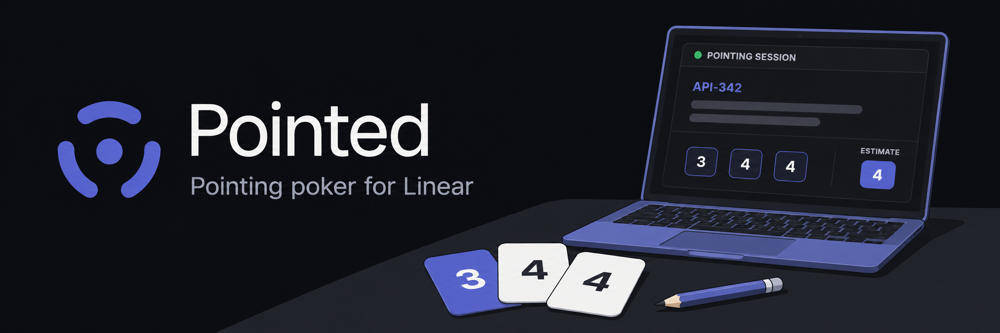

# Pointed

[Open Pointed](https://getpointed.app) · [Try the demo](https://getpointed.app/demo) · [Help](https://getpointed.app/support) · [Privacy](https://getpointed.app/privacy)


The simple, open-source pointing poker app for Linear. A facilitator builds
an ordered issue queue, shares one persistent room link, runs private votes,
and writes the estimate back without switching tabs.

The product decisions behind the configurable workflow are documented in
[`docs/product-research.md`](docs/product-research.md).

## Point together, read independently

Prepare unestimated tickets in a Linear cycle. Load them into Pointed, adjust the agenda, and share a room link. Developers read and vote on their own screens. Reveal, discuss, and let the facilitator save the agreed estimate to Linear.

**Public beta:** single-team weekly use is reported; broader pilot verification is still in progress. See the [launch checklist](docs/launch/READINESS.md) for evidence and remaining limits.

## Local setup

1. Open `/setup` and use the pre-filled Linear OAuth application form. Keep the
   distribution set to **Public** and use this callback:

   `http://localhost:3000/api/auth/linear/callback`

2. Create a Neon database. Follow [database isolation setup](docs/launch/DATABASE-ISOLATION.md) to migrate as the owner and provision the two restricted app connections.
3. Copy `.env.example` to `.env.local` and fill the required values. Generate the token
   key with `openssl rand -base64 32`.
4. After completing the database isolation setup, install dependencies and start the app:

```bash
npm ci
npm run dev
```

Pusher is optional. Leave all six Pusher values blank in `.env.local` for a
5-second polling fallback. For instant updates, fill the four server values and
set `NEXT_PUBLIC_PUSHER_KEY` and `NEXT_PUBLIC_PUSHER_CLUSTER` to the matching key
and cluster. Restart the development server (or rebuild for production) after
changing public values; never expose `PUSHER_SECRET` to the browser.

All Linear teams with estimates enabled appear in the team picker. Every new session
uses the selected team's exact scale. The MVP has no custom deck override;
existing rooms retain their snapshotted cards.

## Verification

```sh
npm run lint
npm run typecheck
npm test
npm run build
```

For browser checks, install Chromium with `npx playwright install chromium`, then
run `npm run test:ui -- --project=desktop --project=phone`. Tests use synthetic
fixtures; they do not verify live Linear, Slack, or Neon integrations.

## Documentation

- [Maintainer guide](docs/maintainer-guide.md): architecture, feature inventory, deployment, and detailed verification.
- [Database isolation](docs/launch/DATABASE-ISOLATION.md): migration owner and restricted runtime roles.
- [Security](SECURITY.md), [state transitions](docs/architecture/state-machines.md), and [Slack setup](docs/slack-setup.md).
- [Contributing](CONTRIBUTING.md), [release notes](CHANGELOG.md), and [MIT license](LICENSE).
