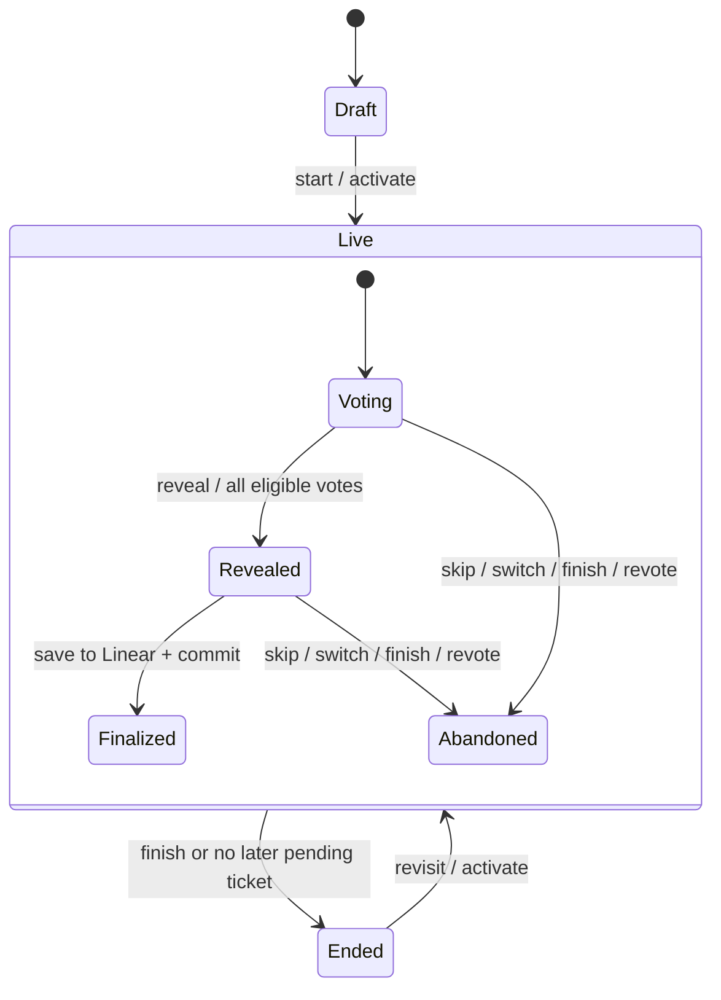

# Pointed state-machine map

Audited 2026-11-09 against GitHub `main` at `9b7ac0b`, plus the round-identity fix in this branch.
This is a source audit of application-owned state in `src/components`, `src/lib`,
`src/app` and `src/db`, with route and browser regression tests. It does not model
Next.js, React, provider internals, or every possible interleaving of requests.
States below describe behavior; most are currently encoded by fields and branches,
not named machine objects. Existing database enums are explicit states with implicit
transition rules.

## Decision

Keep Postgres as the room authority, existing domain helpers as policy, and React
state for local interactions. Make command identity and failure outcomes explicit
at boundaries. Do not introduce a generic machine engine or a durable workflow
runtime across ordinary UI interactions.

This improves UX by preventing a confirmation from saving to a different round,
DX through a small tested contract, and AX through a stable error code and this map.
No schema, stored enum, queue-order policy, vote-privacy rule, or dependency changes
are needed. Other machines retain their current behavior.

## Inventory

Paths are relative to the repository root. Each row is an independently meaningful
lifecycle, including orthogonal states that can coexist.

| # | Machine / owner | States and transitions | Guard, recovery, and decision |
|---|---|---|---|
| 1 | App readiness — `src/lib/env.ts`, `src/app/page.tsx`, `src/app/setup/page.tsx` | Unconfigured → setup; configured → sign-in/app | Keep configuration checks and setup separate from authentication. |
| 2 | Linear OAuth — `src/app/api/auth/linear/{start,callback}/route.ts`, `src/lib/oauth.ts`, `src/lib/complete-login.ts` | Start → state/PKCE cookies → provider → exchange → workspace check → login; invalid/cancelled/failed → auth error redirect | Preserve local return paths, state validation and restricted login role. Transport and persistence failures are separate from denied consent. |
| 3 | App identity — `src/lib/auth.ts`, `src/app/api/auth/logout/route.ts` | Signed out → valid cookie + unexpired DB session → expired/logout/deleted | Database expiry and hashed token lookup are authoritative. |
| 4 | Linear token lifecycle — `src/lib/linear.ts:getLinearAccessToken` | Usable → near-expiry → refresh → encrypted replacement; denied / unavailable | Keep provider uncertainty distinct from denial. Concurrent refresh rotation needs dedicated concurrency coverage before refactoring. |
| 5 | Room access — `src/lib/sessions.ts:requireMembership`, `src/lib/room-access.ts`, `src/components/LiveRoom.tsx` | Authorized → temporarily unverifiable → recovered; confirmed denial → cleared (terminal for mounted room) | 401 or coded room 403 clears data; 503 retains last snapshot; role-only 403 does not clear it. Late success cannot restore a denied room. |
| 6 | Join — `src/components/JoinSession.tsx`, `src/app/api/s/[code]/join/route.ts` | Joining → redirect; failure → retry → joining | Cleanup suppresses late completion. Joining checks current Linear team access and persists membership. |
| 7 | Session creation — `src/components/DashboardClient.tsx`, `src/app/api/sessions/route.ts` | List → editing → submitting → prepare; write-scope upgrade / failure → recovery | Preserve title/team on error. Uses raw fetch rather than bounded `requestJson`; creation idempotency is not established. |
| 8 | Agenda source — `src/components/QueueBuilder.tsx`, `src/lib/session-intake.ts` | Unloaded/loaded → changed source → confirm replacement → loading → loaded/empty/error | Fetch before replacement; transaction locks session and verifies draft plus agenda signature. Failure preserves existing agenda. |
| 9 | Agenda edits — `src/components/QueueBuilder.tsx`, `src/lib/queue.ts`, `src/lib/sessions.ts` | Idle → ordering/removing/clearing/saving/starting → success/error | Client in-flight ref serializes this UI; server policy controls allowed session/item states. Local serialization is not a multi-client lock. |
| 10 | Session lifecycle — `src/lib/sessions.ts`, `src/db/schema.ts` | Draft → live → ended; activation can reopen ended → live | Ended means stopped, not necessarily all tickets completed. Finish returns active ticket to pending. Preserve resumability. |
| 11 | Queue item — `src/lib/sessions.ts`, `src/lib/queue.ts` | Pending → active → estimated/skipped; switching/finish → pending; revisit → active | Active item and session pointer must agree. Forward progression uses `nextPendingItemId`; it intentionally does not wrap to earlier pending items. |
| 12 | Round — `src/lib/rounds.ts`, `src/lib/sessions.ts` | Voting → revealed → finalized; voting/revealed → abandoned; revote creates a new voting row | Never revive an old round. Distinguish round identity from ticket identity. Row locks protect vote/finalize decisions. |
| 13 | Participation / eligibility — `src/lib/sessions.ts:setParticipantRole`, `joinPokerSession` | Observer/voter/facilitator × voting enabled × included in current round | Roles, voting permission and round eligibility are different dimensions. Keep last-facilitator protection and explicit current-round enrollment. |
| 14 | Vote submission / secrecy — `src/components/LiveRoom.tsx:vote`, `src/lib/sessions.ts:castVote`, `src/lib/rounds.ts` | Unvoted → optimistic vote → accepted or refresh after failure; accepted vote → changed vote while voting | Server validates deck and eligibility. Own vote visible; peers hidden until revealed. Commands currently target the server's current round; see remaining work. |
| 15 | Needs-context signal — `src/lib/sessions.ts`, `src/db/schema.ts:roundSignals` | Legacy stored needs-context → read in snapshot → cleared by vote/eligibility change | No current create-signal route was found. Preserve legacy reads; do not describe this as a currently available user action. |
| 16 | Reveal — `src/lib/rounds.ts:shouldAutoReveal`, `src/lib/sessions.ts` | Voting → revealed by facilitator or all eligible votes (auto enabled) | Zero eligible voters does not auto-reveal. Changing eligibility can affect reveal readiness. Preserve vote secrecy boundary. |
| 17 | Estimate selection / writeback — `src/components/LiveRoom.tsx:action`, `src/lib/sessions.ts:finalizeEstimate` | Revealed → selected → saving → conflict → confirmation → saving; saved → next/end; stale → refresh/review; uncertain failure → error | New UI binds every finalize/confirmation to `expectedRoundId`. Server rejects stale identities before Linear I/O. Overwrite bypasses estimate conflict only, never round identity. |
| 18 | Room synchronization — `src/components/LiveRoom.tsx:refresh`, `src/lib/realtime.ts` | Connected ↔ reconnecting/offline/access-unavailable; hidden tab suppresses polling; focus/online resumes | Snapshot request coalescing and polling survive notification loss. `connected` describes last snapshot success, not guaranteed websocket health. Cross-request response ordering is not versioned. |
| 19 | Presence — `src/components/LiveRoom.tsx`, `src/lib/realtime.ts` | Initial online IDs → subscription membership → member added/removed | Presence is advisory; never authorize from online state. Broadcast only opaque IDs. |
| 20 | Browse / preview — `src/components/LiveRoom.tsx` | Following active → browsing another ticket → fetching preview → fresh/cached preview → return/activate | Browsing never advances the shared room. Abort obsolete preview reads; disable vote/save while browsing. |
| 21 | Add-ticket search — `src/components/LiveRoom.tsx:searchAdditionalIssues`, `addIssue` | Closed → query → searching → results/empty/error → adding → success/error | Dialog busy/focus state is separate from request state. Server refetches issues and validates team/eligibility. Search cancellation/response ordering deserves explicit tests. |
| 22 | Destructive confirmation — `src/components/ConfirmDialog.tsx`, `AccountDeletion.tsx`, room/queue handlers | Closed → confirming → committing → success/navigation or error/retry | Keep focus trap/return and busy cancellation guards. Account deletion uses an in-flight ref and transaction; provider estimates remain untouched. |
| 23 | Team defaults — `src/components/SettingsClient.tsx`, `src/lib/team-settings.ts` | Per-team saved/draft → dirty → saving → clean/error; dirty navigation → leave confirmation | Dirty is derived from drafts, not duplicated. Keep per-team drafts and beforeunload protection. |
| 24 | Slack connection / OAuth — `src/components/SlackConnection.tsx`, `src/app/api/auth/slack`, `src/lib/slack-connections.ts` | Loading → connected/disconnected/error → save/disconnect; OAuth → connected/cancelled/expired/failed | Connection ID rotates on replacement. User/workspace ownership and encrypted webhook storage remain authoritative. Simple form state can remain local. |
| 25 | Slack invitation — `src/components/SlackInviteButton.tsx`, `src/lib/slack-invite-request.ts`, `src/lib/slack-connections.ts` | Load destination → needs connection or confirmation → sending → sent / uncertain; reserved → cooldown → available | Preserve destination ID binding and atomic 30-second reservation. Timeout can mean delivered; never automatically retry an uncertain send. |
| 26 | Feedback form / recording — `src/components/FeedbackButton.tsx`, `src/lib/feedback.ts`, `src/lib/feedback-replay.ts` | Closed/editing → sending → sent/error; off → loading recorder → buffering → attached/discarded/stopped | Separate consent/recording from submission. Abort late recorder startup; only explicit attachment uploads; error retains message. |
| 27 | Analytics consent — `src/components/SessionAnalytics.tsx` | Unset → allowed/declined; allowed ↔ declined; storage failure | No tracker load before opt-in. Separate choice persistence from tracker start/stop. Keep cross-tab subscription. |
| 28 | Appearance — `src/lib/theme.ts`, `src/components/SettingsClient.tsx` | System/light/dark preference → resolved light/dark; OS/storage changes | Preference and resolved theme are different state. Keep pre-hydration application and storage fallback. |
| 29 | Clipboard / notices — `CopySetupPrompt.tsx`, room/queue/summary components | Idle → copied → timeout; failure → manual-copy/error; notice → replacement/dismissal/expiry | Local ephemeral state is sufficient. Do not persist or wrap it in a framework. |
| 30 | Elapsed time — `src/lib/timing.ts`, `src/lib/sessions.ts`, room timer | Stopped accumulated time → running timestamp → accumulated on switch/finish → resumed | Persist base + start time, derive display; preserve nonnegative elapsed time and demo behavior. |
| 31 | Demo simulation — `src/components/LiveRoom.tsx:localVote`, `localRound`, `demoAction`, `src/app/demo/page.tsx` | Local versions of voting/reveal/skip/finish/revisit and viewer role changes | No remote writes. Duplicates domain transitions; keep demo contract tests when production policy changes. Demo success is not provider integration evidence. |
| 32 | Page request / error boundaries — `src/app/loading.tsx`, `error.tsx`, `global-error.tsx`, `not-found.tsx` | Loading → page/not-found/error → reset/navigation | Retain framework boundaries; these are separate from recoverable mutation errors inside a room. |

## Coupled persisted transitions



Finalized and abandoned are terminal for that round row. Starting another round
creates a new row; the session can remain live. The diagram describes intended
transitions, not proof of cross-request serializability.

## Finalization contract added here

`POST /api/sessions/:id/actions` accepts:

```json
{"action":"finalize","estimate":2,"expectedRoundId":"the-round-uuid","overwrite":false}
```

`expectedRoundId` is validated as a UUID. The UI captures it on the first save and
retains it through conflict confirmation. A mismatch, missing active round, or
round no longer revealed after locking produces HTTP 409 with `code: "STALE_ROUND"`.
The UI clears its pending selection, refreshes, and asks the user to review again;
it does not present stale state as an overridable Linear estimate conflict.
An ordinary estimate conflict retains the existing confirmation behavior.

Compatibility: the field remains optional for old open tabs/clients. Those clients
retain their prior behavior and do not receive stale-target protection. Require
it in a later coordinated API change after client rollout. Authorization still
runs before round identity checks. Do not automatically retry a finalize request.

## Remaining work, in risk order

1. **Cross-system writeback recovery.** `finalizeEstimate` calls Linear inside a
   Postgres transaction and then fetches the next ticket. A later failure rolls
   back Postgres, not Linear. Audit failure does not prove Linear rejected the
   write. Design a persisted command/outbox with explicit pending, applied,
   reconciled and uncertain states, bound to round + issue + estimate. Test crash
   points and reconciliation before enabling retries. This requires a migration
   and rollout design; it is deliberately not bundled with this compatibility fix.
2. **Multi-facilitator serialization.** Activate, revote, skip and finish read
   session context before their write transactions. Start and agenda replacement
   already lock/recheck the session; other transitions do not consistently use
   that convention. The new round guard prevents stale finalize targeting;
   it is not a complete concurrency protocol. Exercise paired commands against
   real Postgres, then adopt a consistent lock order and stale-command policy.
3. **Other commands lack target identity.** Votes, reveal, skip, revote and preview
   refresh generally mean “current now.” An old tab can act on a newer round.
   Apply expected-round/session-version contracts incrementally with explicit
   compatibility behavior. Local final-estimate selection is keyed to ticket,
   so a revote on the same ticket can retain a prior selection.
4. **Snapshot ordering.** A slow poll can arrive after a successful mutation and
   temporarily replace newer UI data. Coalescing polls does not order independent
   mutation responses. A server revision would also give agents a useful
   read-before-write precondition; test before introducing it.
5. **Async form state.** Slack connection loading/saving, search, token refresh and
   creation use scattered pending/error fields. Add tagged local state only where
   tests show invalid combinations, stale responses or lost edits. A wholesale
   reducer conversion adds risk without establishing correctness.

[Vercel Workflow](https://vercel.com/docs/workflows) and the
[Workflow SDK](https://workflow-sdk.dev/) provide durable execution for crash
recovery and callbacks. Evaluate them for item 1 only after defining provider
idempotency and reconciliation. A durable runtime does not make Linear and
Postgres one transaction, or make uncertain Slack sends safe to retry.

## Change and verification guide

When changing a machine, follow its owner through route validation → domain guard
→ transaction/provider effect → response → UI recovery → fixture/tests. Preserve
privacy, authorization, queue order, timing and confirmation semantics. Update
this map when the contract changes; do not treat the table as executable enforcement.

Relevant existing coverage: `src/lib/sessions-access.test.ts` (real local migrations,
auth lookup, transactions and routes; mocked providers), `rounds.test.ts`,
`queue.test.ts`, `cycle-workflow.test.ts`, `linear-access.test.ts`, `http.test.ts`,
OAuth/Slack/account route tests, `feedback*.test.ts`, and `tests/e2e/room-access.spec.ts`,
`session-polling.spec.ts`, `session-ui-regressions.spec.ts`, `demo.spec.ts`.

New regression coverage rejects stale finalizations with and without overwrite,
checks current-round success, repeat after completion, invalid identity, and
browser confirmation after refresh. Existing no-identity finalization tests
exercise compatibility. Browser tests use synthetic snapshots and mocked network
responses; they do not exercise live Linear or Slack.

No production migration or deployment is included. Rollback is a code revert;
there is no data conversion to reverse. Monitor `STALE_ROUND` separately from
unexpected failures and inspect existing writeback audit events when investigating
uncertain saves. A clean test run cannot guarantee absence of all races.

## Verification of this branch

- `npm test`: 298 tests passed across 39 files.
- `npm run typecheck`, `npm run lint`, `npm run build`: passed with locked dependencies (Next.js 16.4.3).
- `npm run test:ui -- tests/e2e/session-ui-regressions.spec.ts --project=desktop --project=phone`: eight checks passed, including keyboard confirmation, stale-round recovery, notices and summary layout. Desktop and phone summary screenshots inspected.
- `git diff --check`: passed.
- No live provider writes, production deployment, real-Postgres concurrency stress, full browser suite or field performance measurement. Package installation reported 12 moderate advisories in the existing lockfile; dependency remediation is outside this change.

## Graph-assisted review

Code Review Graph was initialized locally on 2026-11-09 using the connected MCP
server. Its postprocessed index reported 170 files, 949 nodes, 12,352 edges and
41 detected flows, with a matching HEAD. Change detection against HEAD highlighted
`apiError`, `action` and `LiveRoomContent` and reported six inferred test gaps.
Those flags are navigation hints, not measured test coverage: the route integration
regressions and browser conflict tests above exercise these paths, including the
new stale-round error. Source/test inspection remains authoritative. Many call
edges are unresolved, so the graph does not prove this state inventory exhaustive.

The upstream Codex skill lives in `.agents/skills/code-review-graph`, is linked
from `AGENTS.md`, and uses the existing MCP connection. Generated graph data is
ignored by Git. No app runtime dependency, external embeddings, watcher, or Git
hook was added. The CLI fallback requires a separately installed CLI; MCP is the
verified path in this environment.

## UI audit presentation changes

The follow-up UI audit is tracked in [UI audit fixes](ui-audit-fixes.md). Room status
now derives “Waiting for voters” from zero round-eligible voters. Ticket/session
elapsed labels explicitly include waiting; stored timing and lifecycle rules are
unchanged. Joining voting delegates to the existing participant-role command.
Mobile Actions is local disclosure state, with Escape/focus recovery; jump-to-vote
moves focus to existing controls without duplicating vote/save state. Ticket search
now exposes the same filters its request sends.

Slack invitation readiness performs an initial read for setup labeling. A later
explicit preview supersedes that read and still fetches the current destination
before confirmation; sends retain connection identity and uncertain-delivery rules.
Feedback distinguishes an invalid message from send/attachment errors, associates
the message error with its field, and reveals/focuses an invalid optional email.
